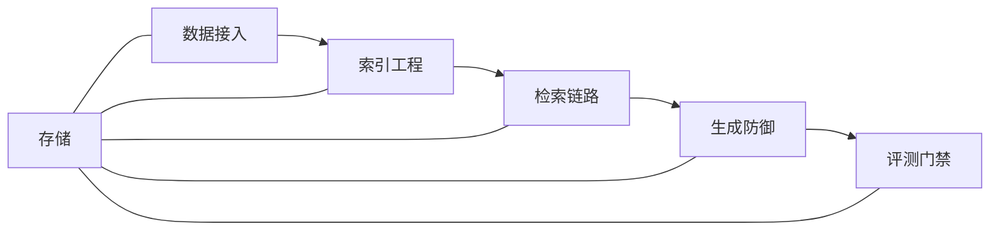
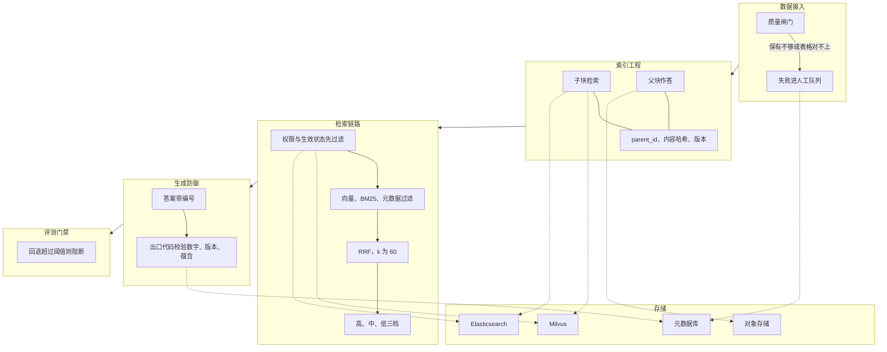

# 企业级 RAG 参考实现

这个仓库公开的是一套制度问答的全链路架构，以及它的可运行重建。

制度先解析再入库。检索时子块负责找准，父块负责把完整条款交给生成。权限和生效状态在检索引擎里先滤掉。答案逐句带编号。数字对不上引用原文、引用到废止版本、句子得不到引用支持，都由出口的代码处理。

真实制度库不在这个仓库里。对外只保留架构、一套合成制度（见 `corpus/README.md`），以及按层排列的验收。合成制度用来把契约跑通，不代表某一家机构的制度。

设计来源是一份企业级 RAG 架构说明。这里用自己的话重写契约，不贴原文。材料里的召回率、幻觉率和文档规模不作为本仓库的结果。

## 1. 一句话定位

制度解析入库，按权限检索条款，生成带出处的答案，再在出口拦住错数字和废止引用：这是制度问答全链路。



六层各自保证：

| 层 | 这一层保证什么 |
| --- | --- |
| 数据接入 | 双栏、跨页表格、扫描件能进库；解析失败进重试和人工队列，不静默丢掉 |
| 索引工程 | 子块检索、父块注入；内容哈希去重；修订按块增量；废止版本留档并可切换 |
| 检索链路 | 原问题与改写一起召回；向量、BM25、权限过滤三路并发；RRF 融合后再精排分流 |
| 生成防御 | 编号引用；数字、版本、蕴含三道校验在代码里执行 |
| 评测门禁 | 检索、生成、端到端分层回归；指标回退阻断发布；拒答日志进入补录 |
| 存储 | Milvus 存向量，Elasticsearch 存倒排，对象存储存原文和版本，元数据库存引用日志和评测 |

父块原文在对象存储。向量库只存子块。查询在版本切换完成前仍读旧版。

## 2. 它解决什么问题

这条链路对着四件会出错的事：

- 解析会吞字。双栏如果只读进一栏，另一栏的条款根本不在库里，后面的检索再准也答不出来。质量闸门没过就重试，多次仍失败就进人工队列，不把这份文件悄悄丢掉。
- 旧版还在被引用。修订还没切换完，或者废止版本仍留在默认检索里，答案会继续引用已经不用的条款。
- 金额会被说错。住宿上限、补贴这类数字，生成时可能说出引用原文里没有的数。
- 不该看的制度会被召回。没有权限的人如果先按相似度取出再事后剔除，受限制度会占满候选，不该看的内容已经进过结果集。

## 3. 演示

已经通过的端到端命令是：

```bash
python -m rag.demo
```

准备好环境之后，用虚拟环境里的解释器跑同一条：`.venv/bin/python -m rag.demo`。它把各层事故收成一次行走，标准输出按格子往下印。中间步骤和终端里的句子对应如下：

| 要看见的步骤 | 终端里对上的结果 |
| --- | --- |
| 闸门 | 解析失败进入人工队列，尝试 3 次，进入索引=否 |
| 增量切换 | 新版还是 pending 时，指针和检索都在 v1；切换后默认版本是 v2，废止版本未出现 |
| 先过滤 | 角色是 intern，引擎权限是 public，受限命中=0，后过滤=否 |
| 三档分流 | 精排之后分成高、中、低：生成并引用、附上可能不完整、拒答并转人工 |
| 出口拦截 | 错误数字被拦住，交卷里没有那个错数；废止引用被拦住，废止金额不交卷 |

事故被接住，看「错误数字被拦住」和「废止引用被拦住」这两行。

### 录制步骤

1. 按第 7 节建好虚拟环境、装上依赖，并执行 `bash deploy/start-storage.sh`。
2. 执行 `.venv/bin/python -m rag.demo`。
3. 把标准输出原样保存为 `docs/demo/e2e-terminal.txt`。

当前证据是 [`docs/demo/e2e-terminal.txt`](docs/demo/e2e-terminal.txt) 这份终端记录，不是屏幕录制。记录共 23 行，读完不用三分钟。

## 4. 架构图

六层都在下面。存储层标的是 Milvus、Elasticsearch、对象存储、元数据库。子块上带着 `parent_id`、内容哈希和版本。权限在检索时推进引擎，不在取出之后再补。



Milvus 只存子块向量。Elasticsearch 存子块的 BM25 倒排。对象存储存父块原文和可切换的版本。元数据库存引用日志、评测条目和解析失败队列。每一格的输入、输出和失败去向写在 [`docs/架构.md`](docs/架构.md)。

## 5. 核心行为

### 子块找、父块答

子块用来检索，父块用来作答。只有子块做嵌入，向量库里没有父块正文。子块 metadata 带 `parent_id`。命中之后按这个编号到对象存储把整条条款取回来，再交给生成。

### 权限和生效状态先过滤

权限、生效状态和文档类型作为标量条件推进检索引擎，在过滤之后的子集上做向量和 BM25。废止和未生效默认不参与检索。无权限的角色看不到受限制度，不是先召回再从结果里挑掉。

### 出口用代码校验

父块以 `[1]` `[2]` 注入，事实句末尾带对应编号。出口三道都是代码：数字必须能在所引用原文里找到，对不上就拦截该句或该答案；引用块若是废止版本，同样拦截；句子得不到引用支持时先删这一句，删完读不通再整条降级或拒答。

## 6. 取舍

### 为什么用 RRF，不把向量分数和 BM25 分数加权

余弦相似度和 BM25 不在同一把尺子上。把它们加权求和，要先定一个权重，换一批制度这个权重未必还合适。RRF 只看名次：每一路加上 `1/(60+rank)`，k 取 60。某一路排得靠前，融合分就上去，不用先把两种分数拉到同一个量纲。

### 为什么权限要下推进引擎

先按相似度取出一批、再丢掉看不见的文档，受限内容会占满前面的名额，该看的公开条款进不了候选，不该看的制度也已经出现在候选里。把权限推进 Milvus 和 Elasticsearch 之后，检索发生在允许看到的子集上。演示里实习生的引擎权限是 public，受限命中是 0，后过滤=否。

### 为什么数字和版本不交给提示词

提示词可以要求不要编造金额、不要引用废止条款，模型仍然可能写错。出口用代码把答案里的每个数字对到所引用原文，对不上就拦住；引用块如果已经废止，同样拦住。这两件事不靠提示词单独保证。

## 7. 快速开始

```bash
python3 -m venv .venv
.venv/bin/pip install -e ".[dev]"
bash deploy/start-storage.sh
.venv/bin/python -m rag.demo
```

最后一行就是 `python -m rag.demo`。四个存储由 `deploy/start-storage.sh` 拉起：Milvus、Elasticsearch、对象存储、元数据库。第一次跑索引、检索、生成或这条演示时，还要先装 CPU 版 PyTorch，并会下载 BGE-M3、bge-reranker-v2-m3 和本机蕴含模型。权重在 `.hf_cache/`，不进 git。演示不加载 Qwen2.5-72B。

## 8. 验收结果

下面是本仓库各层验收已经跑出来的通过情况。

| 层 | 本仓库的结果 |
| --- | --- |
| 存储层 | `pytest tests/storage/live -q`，20 passed |
| 数据接入 | `pytest tests/ingest -q`，16 passed |
| 索引工程 | `pytest tests/index/live -q`，23 passed |
| 检索链路 | `pytest tests/retrieve -q`，27 passed |
| 生成防御 | `pytest tests/generate -q`，29 passed |
| 评测门禁 | `pytest tests/evaluate -q`，40 passed |
| 端到端 | `python -m rag.demo` 退出码 0；`pytest tests/demo -q`，15 passed |

评测数用评测门禁那一次的运行。这是本仓库这次跑出来的：Recall@5 0.8846，出口校验失败算出的幻觉率 0.0833，端到端准确率 0.8462，拒答正确率 1.0000，引用正确率 1.0000。记录在 [`验收/06-评测门禁.md`](验收/06-评测门禁.md)。

## 9. 已知局限

- 仓库里的制度是合成制度，用来把契约跑通，不代表某一家机构的制度库。
- 本机演示所用的生成模型是 `local-extractive`，没有加载权重。vLLM 档的配置保留 Qwen2.5-72B，这次验收没有加载它。
- 材料里的生产规模不在这个仓库的结果里。

## 全部验收

架构自检没有 pytest，核对 [`验收/00-架构自检.md`](验收/00-架构自检.md)。其余各层的命令和通过状态在 [`验收/总览.md`](验收/总览.md)。存储层到端到端，再加上本页的作品集核对，用这一条：

```bash
python3 -m venv .venv && .venv/bin/pip install torch --index-url https://download.pytorch.org/whl/cpu && .venv/bin/pip install -e ".[dev]" && bash deploy/start-storage.sh && .venv/bin/pytest tests/storage/live tests/ingest tests/index/live tests/retrieve tests/generate tests/evaluate tests/demo tests/portfolio -q && .venv/bin/python -m rag.demo
```
