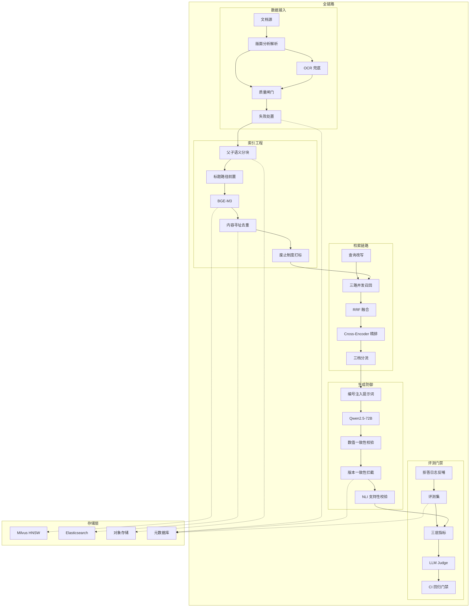

# 架构

这个仓库做的是制度问答的全链路，不是通用聊天。真实制度库不放进来。对外公开架构，并用一套合成制度把契约定下来。合成制度不代表真实客户。

全景图从左到右是数据接入、索引工程、检索链路、生成防御、评测门禁，存储层画在下面。下图每一格都在。存储层不插进从左到右的处理顺序。验收进度把存储层排在数据接入前面，那是实现顺序，不是图上的位置。

材料印在格子上的召回率、幻觉率、耗时、篇数和条数，只记在 `docs/阅读笔记.md`，这里不重复。

层与层之间只传递明确的数据结构。解析、检索、生成不写进同一个模块。下面每一格写输入、输出，以及失败时去哪。没有一格被留空。

## 数据接入

这一层把多个来源的制度文件收成可入库的规范化文本。来源标识要留下来。同一份文本若从多个来源进来，去重留给索引层的哈希，这一层不把后来的来源丢掉。

全景图上「文档源」那一格还印着材料里的规模，数字只在阅读笔记里。

| 格子 | 输入 | 输出 | 失败时去哪 |
| --- | --- | --- | --- |
| 文档源。七个来源把文件交进来，形态包括转发、归档和附件 | 各来源的原始文件 | 带来源标识的文件，交给版面分析 | 某个来源取不到文件：先重试。多次失败写入元数据库的解析失败队列，不进入索引 |
| 版面分析解析。双栏重建，跨页表格合并 | 原始版面：栏、标题、正文、表格、坐标 | 阅读顺序按栏内自上而下、栏间先左后右排好；跨页的同一张表已合并，表头已还原 | 顺序重建不了，或跨页表判不清：换解析参数重试。多次失败进入解析失败队列。版面模型材料没有写死，选型标注「文档未写死」 |
| OCR 兜底。扫描件和盖章 | 没有文本层，或文本层占比过低的页，包括盖章遮挡 | 识别出的文本，送进同一道质量闸门 | OCR 失败：换 OCR 路径重试。多次失败进入解析失败队列。引擎材料没有写死，选型标注「文档未写死」 |
| 质量闸门。字符保有率，表格还原校验 | 解析文本，以及还原后的表格 | 通过闸门的规范化文本 | 字符保有率低于材料所举的示例，或表格行列、抽查单元格对不上：判失败，进入重试。双栏吞掉半栏必须在字符保有率上失败。示例不是写死的线 |
| 失败处置。重试，然后人工队列 | 上面任一格的失败 | 重试成功则回到闸门；仍失败则成为人工队列中的一项 | 人工队列里的文件不会进入索引。队列存在元数据库。队列写不进去时，这份文件不能当成已经入库 |

## 索引工程

检索粒度和生成粒度在这里拆开，不并成一种切块。子块负责检索，父块负责后来注入给生成。父块不做嵌入，不进向量库。

| 格子 | 输入 | 输出 | 失败时去哪 |
| --- | --- | --- | --- |
| 父子语义分块。子块检索，父块注入 | 通过闸门的规范化文本 | 父块按条款，512 到 1024 token。子块 128 到 256 token，metadata 带 `parent_id`、文档编号、版本号、内容哈希。只有子块进入嵌入 | 父块超长：先降成「条款加条项说明」。仍然超长：注入时用父块摘要加上命中子块的全文。不把父块改成子块，也不把父块写入向量库 |
| 标题路径前置。表格按行带表头 | 子块文本；表格 | 嵌入文本前拼上标题路径。表格每一行带表头，行本身能读懂字段 | 表头补不回去：回到数据接入的表格闸门，不把破表当普通段落切进索引 |
| BGE-M3。向量嵌入 | 准备好的子块文本 | 子块向量，写入 Milvus 的 HNSW 索引 | 模型下载或加载失败：停在这一层，不更换模型继续往下。父块全文不写入向量库 |
| 内容寻址去重。按块做差量 | 规范化文本的 SHA-256；新版本逐块的哈希 | 哈希相同则不重复入库、不重复嵌入。新版本分成不变、变化、消失：不变复用向量，变化重新嵌入，消失标记删除 | 定时对账发现漂移：走同一条增量管道修复。禁止先删后插。覆盖过程中不让查询读到半新半旧 |
| 废止制度打标。保留可追溯 | 旧版、新版，以及生效日期 | 旧版带废止标和生效日期区间。检索默认滤掉废止和未生效。审计查询可以显式带出废止版本 | 新版本先全部写完，校验通过后才原子切换。切换完成前查询仍读旧版。切换失败把查询指回旧版。旧版在校验通过前不删，不物理删除 |

父块原文和可切换的版本放在对象存储，命中子块后按 `parent_id` 取回。

## 检索链路

原查询和改写查询都参与召回。三路是向量、BM25 稀疏、元数据过滤。全景图这一格写成「向量 + BM25 + 权限过滤」。正文表的第三行是元数据过滤，硬约束是权限、生效状态和文档类型，所以全景图用权限过滤作这一路的简称。权限与生效状态是这三路里的一路，下推进检索引擎，先过滤再检索。

| 格子 | 输入 | 输出 | 失败时去哪 |
| --- | --- | --- | --- |
| 查询改写。指代消解，复合问题拆解 | 当前问题和对话历史 | 可以单独检索的问题。复合问题拆成 2 到 3 个子查询。原查询一并保留 | 改写失败或改写错了：原查询的召回仍然在。改写用小模型，不占用生成主模型。规格材料没有写死，标注「文档未写死」 |
| 三路并发召回。向量、BM25 稀疏、元数据过滤 | 原查询、改写查询，以及调用者的权限和当前生效条件 | 三路各 top 50。向量：Milvus、BGE-M3、HNSW。BM25 稀疏：Elasticsearch，条款编号保留原始 token。元数据过滤：权限、生效状态、文档类型在引擎内先滤，再在子集上检索 | 延迟取最慢的一路。某一路引擎不可用：这次按检索失败写入拒答日志，不用另外两路的结果做后过滤来充数。无权限角色的受限制度不出现在候选里。后过滤不是通过路径 |
| RRF 融合。免分数归一化 | 三路的名次 | 融合分是各路 `1/(k+rank)` 之和，k 为 60。不把余弦和 BM25 分数加权 | 某一路没有候选：这一路不贡献分数，其余路照常融合。三路都空：进入低分拒答 |
| Cross-Encoder 精排。bge-reranker-v2-m3 | RRF 之后的 top 50 到 top 100 | top 5 | 模型加载失败：停在这一层，不更换模型。区间内的具体候选数若自定，标注「文档未写死」 |
| 三档分流。高分作答，中分提示，低分拒答 | 精排分数 | 高分：生成答案并引用。中分：生成答案，并写明可能不完整、建议人工核实。低分：拒答并转人工 | 低分和转人工写入拒答日志。高、中、低的分数线在评测集上标定，标注「文档未写死」 |

## 生成防御

检索层的先过滤是第一道。编号引用是第二道。出口三道是第三道，都由代码执行，不靠提示词单独保证。

| 格子 | 输入 | 输出 | 失败时去哪 |
| --- | --- | --- | --- |
| 编号注入提示词。逐句标注来源 | 从对象存储按 `parent_id` 取回的父块 | 提示词中的 `[1]` `[2]` `[3]`。事实句末尾带对应编号 | 父块取不回：不生成没有出处的句子，拒答并写引用日志 |
| Qwen2.5-72B。vLLM，prefix caching | 稳定前缀：系统说明、格式约束、引用规则。变化段：检索块和用户问题 | 带编号的草稿答案。本机演示档和 vLLM 档走同一套引用格式、同一套出口校验。vLLM 档的配置保留 Qwen2.5-72B | 生成失败：不跳过出口校验。验收不要求本机加载 72B。未实测的首 token 延迟和吞吐不写进 README |
| 数值一致性校验。数字必须见于引用原文 | 草稿里的数字，以及所引用块的原文 | 对得上的句子放行 | 对不上：拦截该句或该答案，并写入引用日志 |
| 版本一致性拦截。全景图写废止版本直接拒答 | 引用块的版本和生效日期区间 | 仍生效的引用放行 | 按正文验收：命中废止版本时，拦截该句或该答案。这一格保留，拦截结果写入引用日志 |
| NLI 支持性校验。全景图写不通过删句 | 每个句子，以及它的引用块 | 得到支持的句子保留。判定包含支持、中立、矛盾 | 按正文验收：不支持的句子先删。删完还读得通，就只删这一句。删完读不通，整条降级或拒答。字符串全等不算蕴含通过。蕴含模型的名字材料没有写死，标注「文档未写死」。误删样本进入 badcase |

## 评测门禁

评测集、指标、裁判、门禁、拒答日志都在这一层。材料印在评测集格子上的条数只在阅读笔记里。

两套指标都算。材料正文那一套：检索是 Context Recall、Context Precision、Recall@5；生成是 Faithfulness、Answer Relevancy；端到端是答案准确率、拒答正确率、引用正确率、耗时。提示词那一套：检索看该找的条款有没有进上下文，并报告 Recall@5；生成看答案是否被引用支持；端到端看准确率、拒答正确率、引用正确率、耗时。

门禁卡本仓库自己的三个数：Recall@5、出口校验失败算出的幻觉率、端到端准确率。拒答正确率和引用正确率同时报告。评测报告只写本仓库这次跑出来的数。

| 格子 | 输入 | 输出 | 失败时去哪 |
| --- | --- | --- | --- |
| 评测集。采样，边界构造，badcase 固化 | 贴近提问分布的采样；边界用例；已修复的 badcase | 三类都有条目的评测集，条目存入元数据库。边界至少覆盖新旧版本、废止、跨条款、权限、表格里的数字。规模按本地能跑完来建 | 缺了某一类：这一层不能当成通过。不把材料里的条数抄成自己的条数 |
| 三层指标。检索，生成，端到端 | 评测条目和当次运行结果 | 上面两套指标都算出。归因先看检索有没有把该找的条款送进上下文，再看答案是否被引用支持 | 端到端掉了却分不清层：先查检索指标，再查生成指标，不拿生成侧的修改去补检索 |
| LLM Judge。人工双轨校准 | 答案、引用块、可执行清单 | 结构化字段：错误点、错误类型、支持依据。清单逐项判定：数字是否在引用原文中、是否引用废止版本、每句是否被引用支持 | 没有裁判模型：门禁以可执行清单为准，验收里写明。有裁判模型：版本钉死，并保留人工对照。裁判升级要重标基线 |
| CI 回归门禁。指标回退阻断发布 | 对提示词、topK、分流阈值、RRF 的 k 或生成模型的变更 | 分层回归。三个门禁指标相对本仓库基线比较 | 回退超过自定阈值：阻断合并或发布。阈值标注「文档未写死」。拒答正确率和引用正确率与三个门禁指标一起报告 |
| 拒答日志反哺。驱动知识补录 | 低分拒答、出口拦截、权限不足 | 日志分成知识缺失、检索失败、权限不足。知识缺失进入补录队列 | 知识缺失未补录：对应用例继续失败，回归能看见。补录之后再跑对应用例。检索失败和权限不足不混进补录队列 |

## 存储层

四个存储都在架构里。向量库只存子块，不存父块全文。

| 格子 | 输入 | 输出 | 失败时去哪 |
| --- | --- | --- | --- |
| Milvus。向量检索，HNSW | 子块向量，以及权限、生效状态、文档类型等标量 | 在先过滤之后的子集上做近邻检索 | 服务不可用：检索失败写入拒答日志。不用内存里的替身充当这一格已经接通。父块全文不写入这里 |
| Elasticsearch。BM25 倒排 | 子块文本、条款编号的原始 token、过滤条件 | BM25 命中。filter context 不参与打分 | 服务不可用：与向量一路同样记为检索失败，不做后过滤 |
| 对象存储。原始文档，版本快照 | 父块原文；新版本的完整内容 | 按编号取回父块。版本可以切换：新版本全部写完并校验通过后才切指针；切换完成前查询读旧版 | 取回失败：生成侧拒答，不编造出处。切换失败：查询指回旧版。旧版在切换校验通过前不删 |
| 元数据库。引用日志，评测记录 | 引用日志、评测条目、解析失败队列 | 可查询的引用记录、评测条目、人工队列 | 引用日志写不进去：这次回答不能当成已经审计。解析失败队列写不进去：对应文件不能当成已经入库。评测条目写不进去：这次回归不能当成已经留下记录 |

## 目录边界

层与层的代码边界沿用这些目录名。这次只把边界写在这里，不创建这些目录，也不写实现。

- `src/rag/ingest/`：来源、版面、OCR、质量闸门、重试、人工队列
- `src/rag/index/`：父子分块、嵌入、哈希、增量、废止、版本切换
- `src/rag/retrieve/`：改写、三路召回、RRF、精排、三档分流
- `src/rag/generate/`：提示词、前缀分段、生成适配、数字、版本、蕴含
- `src/rag/evaluate/`：评测集、三层指标、裁判、门禁、拒答日志
- `src/rag/storage/`：Milvus、Elasticsearch、对象存储、元数据库
- `corpus/`：合成制度，以及对应的权限、版本、评测条目
- `deploy/`：本地的 Milvus、Elasticsearch、对象存储、元数据库
